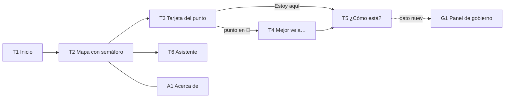

# 🖥️ Especificación del frontend

> [!info] Para qué es esta nota
> Junta todo lo necesario para construir la maqueta y después la app: **qué pantallas hay, qué muestra cada una, de qué caso de uso y endpoint sale, qué componentes usa y qué reglas se ven**. Fuentes: casos de uso y reglas de [[10 - Análisis FIS]], endpoints y componentes de [[05c - Backend FastAPI y frontend React]], y contenido de [[02 - Problema y propuesta]]. Responsable: Angel.
>
> **Maqueta:** `frontend/maqueta/index.html` (HTML estático, baja fidelidad, marcos de computadora). La app real es **responsiva**: en el stand se abre por QR en el celular (RNF_03).

## 1. Mapa de pantallas

| ID | Pantalla | Ruta | CU | Usuario |
|---|---|---|---|---|
| T1 | Inicio: ¿qué te gusta y cuánto tiempo tienes? | `/` | CU_01 | Turista |
| T2 | Mapa con semáforo | `/` | CU_02, CU_08 | Turista |
| T3 | Tarjeta del punto | `/` (panel lateral) | CU_03 | Turista |
| T4 | "Mejor ve a…" | `/` (panel lateral) | CU_04 | Turista |
| T5 | "¿Cómo está?" | `/` (modal) | CU_05 | Turista |
| T6 | Asistente | `/` (panel lateral) | CU_06 | Turista |
| G1 | Panel de gobierno | `/panel` | CU_07 | Funcionario |
| A1 | Acerca de y privacidad | `/acerca` | — (RN_07, RN_13) | Todos |

## 2. Fichas de pantalla

### T1 — Inicio
- **Objetivo:** que el turista diga en 10 segundos qué le gusta, cuánto tiempo tiene y dónde está.
- **Endpoint:** `POST /api/sesiones` con `perfil` → `sesion_id`.
- **Contenido:** pregunta principal "¿A dónde voy ahora?"; intereses como botones seleccionables (historia, gastronomía, naturaleza, compras, arte, familia, pueblos mágicos); tiempo disponible (2 h, medio día, todo el día); "Estoy en…" con una lista de lugares (sin GPS en la demo, [[05c - Backend FastAPI y frontend React]] §4); botón "Ver qué me conviene".
- **Componentes:** `SelectorUbicacion`, datos de `data/intereses.js`.
- **Reglas visibles:** RN_07 en una línea: "Sin registro. No guardamos tu ubicación".

### T2 — Mapa con semáforo
- **Objetivo:** ver de un vistazo qué conviene ahora.
- **Endpoints:** `GET /api/semaforo?origen_id=…`, `GET /api/puntos`.
- **Contenido:** mapa de la zona piloto con un marcador por punto; lista ordenada por conveniencia a un lado (nombre, color, razón corta, traslado); leyenda del semáforo; indicador "En vivo" con la hora.
- **Componentes:** `Mapa`, `EnVivo`.
- **Estados:** cargando; sin conexión → "Mostrando datos de hace X min" (RNF_02).
- **Reglas visibles:** RN_01 en la leyenda (incluye el gris **Sin dato**); RN_09 ("estimado" / "confirmado por turistas") en cada punto; RN_11: la demo es en vivo (sin escenarios desde el 2026-10-15); las sesiones del stand se marcan como demo en el backend.

### T3 — Tarjeta del punto
- **Objetivo:** saber si conviene ir y por qué.
- **Endpoint:** `GET /api/puntos/{id}/estado`.
- **Contenido:** nombre, foto o ícono del tipo, semáforo con su **razón** (afluencia, lluvia, traslado, evento); confianza y "normalmente … a esta hora" si no hay reportes; clima de las próximas horas; traslado desde donde está el turista; horario y costo; duración sugerida; ficha corta. Botones: **"Estoy aquí"** y, si está en 🔴 o 🟡, **"Mejor ve a…"**.
- **Componentes:** `TarjetaPunto`.
- **Reglas visibles:** RN_03 (razón), RN_09 (confianza), RN_16: si la Secretaría fijó el color, se ve "Ajustado por la Secretaría: *motivo*".

### T4 — "Mejor ve a…"
- **Objetivo:** dar una alternativa concreta y convencer con la razón.
- **Endpoints:** `POST /api/recomendar` → alternativa + razón + `busqueda_id`; `POST /api/busquedas/{id}/aceptar`.
- **Contenido:** comparación lado a lado: punto pedido (🔴 y por qué) contra alternativa (🟢 y por qué se parece); traslado; un *tip* ("regresa el lunes a las 10:00"); botones **"Vamos"** (acepta y abre "Cómo llegar") y "Prefiero mi plan".
- **"Cómo llegar":** enlace a Google Maps con el destino (`https://www.google.com/maps/dir/?api=1&destination=lat,lon`). No usa la API de Google: sin costo ni clave ([[08 - Preguntas abiertas y riesgos]]).
- **Componentes:** `Recomendacion`.
- **Reglas visibles:** RN_02 (nunca recomienda un 🔴), RN_03.

### T5 — "¿Cómo está?"
- **Objetivo:** reportar en un clic y sentir que sirvió.
- **Endpoint:** `POST /api/reportes`.
- **Contenido:** tras "Estoy aquí": tres botones grandes **Vacío 🟢 / Normal 🟡 / Lleno 🔴**, más el campo opcional "¿cuánto esperaste?". Confirmación: "¡Gracias! Tu reporte ya ayuda a quien viene detrás" y el nuevo estado del punto.
- **Componentes:** `BotonReporte`.
- **Estados:** aceptado; límite → "Ya reportaste este lugar; podrás volver a hacerlo en 30 min" (RN_05).
- **Reglas visibles:** RN_04, RN_05.

### T6 — Asistente
- **Objetivo:** responder preguntas abiertas ("tengo 4 horas y llueve, ¿qué hago?") solo con nuestros datos.
- **Endpoint:** `POST /api/chat` → `respuesta`, `fuentes[]`, `estado_usado[]`.
- **Contenido:** conversación; debajo de cada respuesta, las **fuentes citadas** y la tabla de estado que recibió el modelo (desplegable); 3 preguntas sugeridas.
- **Componentes:** `Chat`.
- **Estados:** "Pensando…" (hasta 15 s, RNF_04); sin dato → "No tengo ese dato".
- **Reglas visibles:** RN_10.

### G1 — Panel de gobierno
- **Objetivo:** que el funcionario vea en 30 segundos dónde hay saturación, a dónde se están yendo los turistas y **cuánto dinero llegó**.
- **Endpoints:** `GET /api/panel/afluencia`, `/redirecciones`, `/derrama`, `/semaforo-estatal`, `/umbrales`; `POST /api/panel/ajustes`.
- **Contenido:** 4 indicadores arriba (redirecciones aceptadas hoy, **derrama redistribuida**, **derrama nueva estimada**, reportes recibidos); mapa de calor de la zona piloto; tabla "de dónde → a dónde → por qué"; semáforo estatal mensual de los 20 destinos; en cada punto, botón **"Fijar color"** (color, motivo y hasta qué hora) y sus umbrales `bajo`/`alto` para explicar por qué tiene ese color.
- **Componentes:** `panel/MapaCalor`, `panel/Redirecciones`, `panel/Derrama`.
- **Reglas visibles:** RN_12 (solo agregados), RN_14 (dos cifras de derrama con su supuesto), RN_11 (interruptor "Contar la demo del stand"), RN_16 (ajuste manual con motivo y hora de fin).

### A1 — Acerca de y privacidad
- **Contenido:** qué es la app y quién la hizo; **atribuciones** (© colaboradores de OpenStreetMap, ODbL; datos meteorológicos de Open-Meteo, CC BY 4.0; INEGI; Secretaría de Cultura, SIC; Observatorio Turístico; INAH); aviso de privacidad corto (sin cuenta, sesión anónima, ubicación no guardada, solo agregados al gobierno).
- **Reglas visibles:** RN_07, RN_13.

## 3. Criterios de UX (Interacción persona máquina)

| Criterio | Cómo se cumple |
|---|---|
| **El color no es la única señal** (WCAG) | Cada estado del semáforo lleva **color + ícono + texto**: 🟢 ✓ "Buen momento" · 🟡 ! "Con precaución" · 🔴 ✕ "Mejor después" · ⚪ ? "Sin dato" |
| **Contraste** ≥ 4.5:1 en texto normal | Texto de estado en tonos oscuros sobre fondo claro (ver la paleta) |
| **Objetivos táctiles** ≥ 24 × 24 px | Botones de reporte e intereses de 44 px de alto o más |
| **Claridad** | Una pregunta por pantalla; botones que dicen lo que hacen ("Vamos", no "OK") |
| **Retroalimentación** | Confirmación visible después de reportar y de aceptar una alternativa |
| **Prevención de errores** | "Estoy aquí" antes de reportar; límite de reportes explicado |
| **Mensajes de error** | Dicen qué pasó y qué hacer ("Sin conexión: mostramos el último dato, de hace 12 min") |
| **Lenguaje** | El del turista: "lleno", "llueve", "45 min en coche"; nada de "índice" ni "nowcast" en la vista del turista |
| **Honestidad** | "Estimado" o "confirmado por turistas" siempre visible; la simulación siempre rotulada |

### Paleta del semáforo

| Estado | Fondo | Texto e ícono |
|---|---|---|
| 🟢 Buen momento | `#DCF2E3` | `#14662E` |
| 🟡 Con precaución | `#FFF1C2` | `#6B4A00` |
| 🔴 Mejor después | `#FBE0DE` | `#9E1C14` |
| ⚪ Sin dato | `#ECEDEF` | `#3F4650` |

## 4. De la maqueta a React

La app vive en `frontend/` (React 19 + Vite). Cada sección de la maqueta (`data-componente`) es un componente:

| Maqueta | Componente en `frontend/src/` |
|---|---|
| `SelectorUbicacion` | `components/Inicio.jsx` (T1: intereses, tiempo y "¿Dónde estás?") |
| `Mapa` | `components/Mapa.jsx` (Leaflet + OpenStreetMap) |
| `EnVivo` | `components/EnVivo.jsx` |
| Lista de T2 | `components/ListaPuntos.jsx` |
| `TarjetaPunto` | `components/TarjetaPunto.jsx` |
| `Recomendacion` | `components/Recomendacion.jsx` |
| `BotonReporte` | `components/BotonReporte.jsx` (modal) |
| `Chat` | `components/Chat.jsx` |
| `MapaCalor`, `Redirecciones`, `Derrama`, `FijarColor`, `Umbrales` | `components/panel/…` (`Derrama` → `Indicadores.jsx`) |

**Datos:** todas las llamadas pasan por `api/cliente.js` y van a la API de Axel ([[05c - Backend FastAPI y frontend React]]; contrato exacto en `backend/app/schemas.py`). Los componentes usan los nombres del backend tal cual (`id`, `clave`, `color`, `razon`, `nivel`, `traslado.minutos`). Desde el 2026-10-15 no hay datos de demostración ni escenarios: el semáforo es el de la hora real y la cabecera lo dice ("En vivo"). En el stand, FastAPI sirve el build del frontend en el mismo puerto que la API.

## 5. Lenguaje visual

Objetivo: una interfaz que **invite a usarla**, se entienda sin explicación y se sienta como un producto terminado. Referencia: la coherencia tipográfica y de bordes de Apple.

| Elemento | Decisión |
|---|---|
| Tipografía | **Inter** (variable), empaquetada con la app (`@fontsource-variable/inter`): idéntica en la laptop y en cualquier celular, **sin internet**. Títulos con espaciado negativo ligero; cifras con números tabulares |
| Radios | 12 px (elementos chicos), 16 px (tarjetas), 24 px (paneles y modales), píldora (botones de opción y chips) |
| Color | Tinta casi negra `#1F1F1F` sobre crema `#F6F7ED` y blanco; el color fuerte se reserva al **semáforo** (verde, ámbar, rojo, gris) |
| Superficies | Paneles blancos translúcidos con desenfoque sobre el mapa; sombras suaves |
| Controles | Control segmentado para opciones excluyentes; chips para intereses; botón primario negro de 48 px de alto |
| Mapa | Mosaicos de OpenStreetMap en escala de grises: el único color en el mapa es el del semáforo |
| Celular | El panel se vuelve hoja inferior; el asistente, un botón flotante; etiquetas cortas en la cabecera |

**Qué se tomó de las referencias visuales** (capturas de diseños de terceros que guarda Angel en `frontend/webDesignInspo/`; **no se suben al repo** por derechos de autor, se toman ideas, no diseños):

| Referencia | Se tomó | Se dejó fuera |
|---|---|---|
| Mapa de rastreo con panel flotante | Mapa a pantalla completa, panel blanco flotante, tarjeta seleccionada con borde, control segmentado | — |
| Dashboard con paleta crema y tinta | Paleta sobria, botones primarios negros, cifras grandes | Su fuente (General Sans requiere internet; se usa Inter) |
| App de viaje en celular | Inicio en tarjeta sobre el fondo, campos y chips en píldora, botón de acción grande | Morado y degradados (chocan con el semáforo) |
| Dashboard de ventas con asistente de IA | Indicadores con contexto y tarjeta de asistente con orbe y campo "pregúntame…" | Barra lateral de muchas secciones |
| Dashboard cripto oscuro | Jerarquía de números grandes | Tema oscuro y neón |
| Mapa de calor urbano | Halos de calor sobre los lugares, barras de proporción | Fondo oscuro |

## 🔗 Relacionado
- [[05c - Backend FastAPI y frontend React]]
- [[10 - Análisis FIS]]
- [[11 - Entregables y estructura]]

---
#hackathon #frontend
